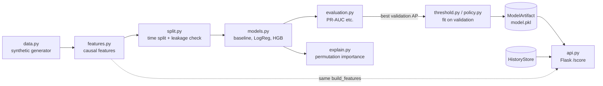

# Fraud Detection on Imbalanced Data

An end-to-end, leakage-aware fraud-detection pipeline: a seeded synthetic transaction generator (~1% fraud), causal velocity / z-score / time-of-day features, a chronological train/validation/test split, class-weighted models compared on PR-AUC, a cost-sensitive decision threshold, permutation importance, and a Flask endpoint that returns an approve / review / block decision.

> **All data is synthetic.** The generator encodes my own assumptions about how fraud looks (night-time bursts, large amounts relative to a user's history, risky merchant categories, country mismatch). The metrics below show that the **pipeline works end to end**. They say nothing about performance on real payment traffic.

## Problem

Card fraud is rare (about 1% of rows here), so a model that approves everything is ~99% "accurate" and useless. The task is to:

1. rank transactions by fraud risk without peeking at the future,
2. choose an operating point from the business cost of a false positive vs. a missed fraud, not from a default 0.5 cutoff,
3. serve the decision online with the same features used in training.

## Features

- **Seeded synthetic generator** (`data.py`): 150,000 transactions, 3,000 users, 90 days, 1% fraud by default. Legitimate users have log-normal spending, a preferred hour and category preferences. Fraud arrives as episodes of 1-5 transactions a few minutes apart on one user; ~30% of episodes mimic the victim's normal spending, and 1% of legitimate purchases are deliberately large (hard negatives). Fully determined by the seed.
- **Causal features** (`features.py`): velocity counts over 10 min / 1 h / 24 h, 24 h amount sum, expanding per-user z-score of log-amount (needs at least 3 prior transactions, std floored at 0.25), time since previous transaction, history length, hour sin/cos, night flag, online flag, country mismatch, one-hot merchant category. Each feature uses only the current and earlier transactions of the same user.
- **Time-based split with a leakage check** (`split.py`): cut points at fractions (60/20/20) of the time span; optional embargo gap; `assert_no_temporal_leakage` verifies train < val < test and no shared rows. Tests confirm it catches a random split.
- **Models** (`models.py`): rule baseline (per-user amount z-score), class-weighted `LogisticRegression` (standardised), `HistGradientBoostingClassifier` with and without balanced class weights. Early stopping is off because sklearn's internal validation split is random and would reintroduce temporal leakage.
- **PR-AUC-driven evaluation** (`evaluation.py`): average precision (model selection metric), ROC-AUC, prevalence, precision at 80% recall, recall at 50% precision, precision/recall in the top 1% of scores.
- **Cost-sensitive threshold** (`threshold.py`): exhaustive search over every distinct score minimising `FP * C_fp + FN * C_fn` (defaults 10 and 150).
- **Approve / review / block policy** (`policy.py`): two thresholds fitted on validation scores to minimise total cost, including a per-review cost (default 2).
- **Permutation importance** (`explain.py`): drop in held-out average precision when a feature is shuffled.
- **Flask scoring service** (`api.py`): `POST /score`, `GET /health`, `GET /policy`; pydantic request validation; an in-memory per-user history store so online features come from the same `build_features` code as training.

## Architecture



| Component | File | Role |
|---|---|---|
| Data generator | `src/fraud_detection/data.py` | Seeded synthetic transactions with fraud episodes |
| Features | `features.py` | Causal velocity, z-score, time-of-day, category features |
| Split | `split.py` | Chronological split and leakage assertion |
| Models | `models.py` | Rule baseline, LogReg, HGB; `make_models` |
| Evaluation | `evaluation.py` | PR-centric metrics, confusion counts |
| Threshold | `threshold.py` | `CostModel`, cost-optimal binary threshold |
| Policy | `policy.py` | `DecisionPolicy`, `fit_policy`, `policy_cost` |
| Explainability | `explain.py` | Permutation importance on average precision |
| Pipeline | `pipeline.py` | `run_pipeline`, `ModelArtifact` (pickle save/load) |
| API | `api.py` | Flask app factory, `HistoryStore`, `score_transaction` |
| Demo | `scripts/run_demo.py` | Runs everything, writes `reports/` and `artifacts/model.pkl` |

## Design decisions and trade-offs

- **PR-AUC, not accuracy.** At 1% prevalence, accuracy rewards predicting "legit" always. Average precision focuses on the rare class, and the prevalence is reported alongside it (a random ranker scores about the prevalence). ROC-AUC is reported but looks flattering with so many negatives. A test demonstrates the accuracy/PR-AUC contrast.
- **Time split, not random.** Fraud is bursty and user-specific; a random split would put neighbours of the same episode on both sides and inflate scores. The split is chronological, and features are causal so they can be computed once on the full table (a test checks that truncating the future does not change any feature). Trade-off: the validation and test fraud rates differ (1.20% vs 1.02%), so single numbers are noisy.
- **Cost-based threshold, not 0.5.** A class-weighted model's probabilities are not calibrated, so 0.5 has no business meaning. The threshold is chosen from the FP/FN costs and fit on validation only; test numbers are pure hold-out. Trade-off: the result is only as good as the assumed costs (defaults are illustrative, not from a real merchant).
- **Three-way policy with a perfect-reviewer assumption.** `policy_cost` assumes reviewed fraud is always caught and reviewed legit is approved, at a flat cost per review. That makes review cheap and pushes the fitted policy toward a wide review band; real reviewers err and have limited capacity.
- **Model selection by validation PR-AUC.** Chosen model is `hgb_balanced`, but its edge over `hgb_plain` and logistic regression on validation is small (see below), so the choice is not strongly supported.
- **Train/serve parity.** The API calls the same `build_features` on the user's stored history plus the new transaction; a test checks online and offline features match.

## Running it

Requires Python 3.11+.

```bash
pip install -r requirements.txt           # or: pip install -e ".[dev]"
PYTHONPATH=src python3 -m pytest -q       # 54 tests
python3 scripts/run_demo.py               # options: --n 150000 --seed 42 --out reports
```

The demo writes `reports/*.csv`, `reports/summary.json` and `artifacts/model.pkl`.

There is no serve script; start the API from Python with the saved artifact (the pickle is trusted-input only):

```python
from fraud_detection.pipeline import ModelArtifact
from fraud_detection.api import create_app
from fraud_detection.data import generate_transactions

art = ModelArtifact.load("artifacts/model.pkl")
app = create_app(art, history=generate_transactions(seed=42))  # optional history seed
app.run(port=5000)   # Flask development server
```

```bash
curl -s localhost:5000/score -H 'Content-Type: application/json' -d '{
  "user_id": 7, "timestamp": "2024-03-10T03:12:00Z", "amount": 950.0,
  "merchant_category": "gift_cards", "is_online": true,
  "country_mismatch": true, "record": false }'
```

Response from an actual call (via Flask's test client) against the demo model: `decision: "block"`, `score: 0.9999`, with `amount_z_user` 5.19 and `is_night` 1. `record: false` scores without adding the transaction to the user's history. Invalid payloads return HTTP 400.

## Results (synthetic data, seed 42, 150,000 transactions)

Copied from the output of `python3 scripts/run_demo.py`.

Split (chronological):

| Partition | Rows | Fraud rate |
|---|---|---|
| train | 90,228 | 0.93% |
| val | 30,059 | 1.20% |
| test | 29,713 | 1.02% |

Test (hold-out) metrics:

| Model | PR-AUC (AP) | ROC-AUC | Precision @ 80% recall | Recall @ 50% precision | Precision top 1% | Recall top 1% |
|---|---|---|---|---|---|---|
| rule_amount_z | 0.2027 | 0.7908 | 0.0169 | 0.1490 | 0.2997 | 0.2947 |
| logreg_balanced | 0.8315 | 0.9884 | 0.6934 | 0.8377 | 0.7946 | 0.7815 |
| hgb_plain | 0.8369 | 0.9827 | 0.8013 | 0.8411 | 0.8081 | 0.7947 |
| hgb_balanced | 0.8384 | 0.9821 | 0.7139 | 0.8543 | 0.7879 | 0.7748 |

Test prevalence is 0.0102. Validation AP: rule 0.2189, logreg 0.8578, hgb_plain 0.8582, hgb_balanced 0.8609, so `hgb_balanced` was selected. The three learned models are within about 0.01 AP of each other on both partitions.

Decisions (fit on validation, evaluated on test; costs FP=10, FN=150, review=2):

- Cost-optimal binary threshold: 0.0536. Test confusion: TP 258, FP 331, FN 44, TN 29,080.
- Policy thresholds: review at 0.0302, block at 0.9978. Test decisions: approve 29,003, review 595, block 115.

| Strategy | Test cost |
|---|---|
| Approve everything | 45,300 |
| Threshold 0.5 | 10,810 |
| Cost-optimal threshold | 9,910 |
| Three-way policy | 7,190 |

Top permutation importances (drop in test PR-AUC): `log_secs_since_prev` 0.1437, `country_mismatch` 0.0892, `is_online` 0.0776, `log_history_len` 0.0623, `amount_z_user` 0.0292, `log_amount` 0.0286, `is_night` 0.0255, `txn_count_1h` 0.0135. These reflect how I built the generator (fraud episodes, country mismatch, online bias), not real fraud.

## Limitations

- **Synthetic data only.** Fraud patterns are my assumptions; there is no real-world validation, concept drift, adversarial adaptation or label noise. Real results would be much lower and would need re-tuning.
- Single seed and single split; no confidence intervals or cross-validation over time.
- Cost values are illustrative; the review cost model assumes a perfect reviewer and unlimited capacity.
- Not calibrated: scores from class-weighted models are rankings, not probabilities.
- The API keeps history in process memory (lost on restart, not shared across workers), runs on Flask's dev server, and has no auth, monitoring or retraining loop.
- Model artifacts use pickle; load only files you created.
- Label delay is modelled only through an optional `gap_seconds` embargo, which the demo leaves at 0.
- Permutation importance is a guide, not causal attribution; correlated features share credit.

## License

MIT, see `LICENSE`.
